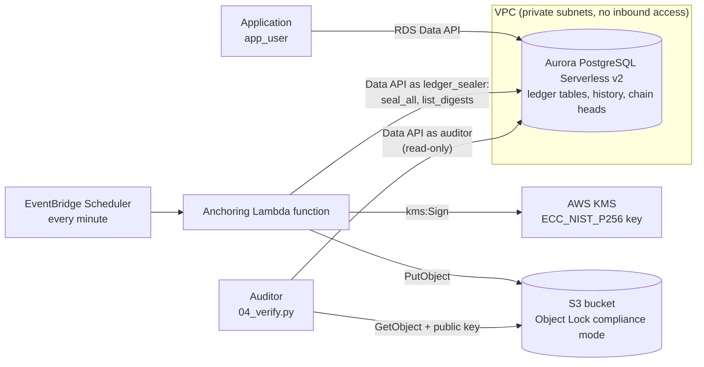

# Tamper-evident ledger for Amazon Aurora PostgreSQL

This sample keeps a verifiable change history of ordinary PostgreSQL tables. Every insert, update
and delete is appended to a history table and linked into a SHA-256 hash chain. Once a minute, the
latest hash of every chain is signed with an AWS KMS asymmetric key and written to an Amazon S3
bucket with Object Lock in compliance mode. An auditor can then prove, using only the public key,
that history has not been rewritten, truncated or rolled back since it was anchored, including by
a database administrator.

> **Note:** This is sample code, for non-production usage. You should work with your security and
> legal teams to meet your organizational security, regulatory and compliance requirements before
> deployment.

A Chinese version of this guide is in [README.zh-CN.md](README.zh-CN.md).

**Relationship to the AWS guidance for replacing Amazon QLDB.** The AWS Database Blog posts
*Replace Amazon QLDB with Amazon Aurora PostgreSQL for audit use cases* and *Migrate an Amazon
QLDB Ledger to Amazon Aurora PostgreSQL* (July 2024; the English pages now redirect, the AWS Japan
translations remain available: [replace](https://aws.amazon.com/jp/blogs/news/replace-qldb-with-amazon-aurora-postgresql/),
[migrate](https://aws.amazon.com/jp/blogs/news/amazon-qldb-to-aurora-postgresql/)) describe the building blocks: trigger-maintained audit tables (rows stored as JSON), pgAudit with
logs kept in Amazon CloudWatch Logs, and Database Activity Streams as the trusted record of database
administrator activity, kept in Amazon S3. This sample implements those building blocks and adds one
that the posts leave to you: a hash chain whose head is signed and anchored outside the database, so
an auditor can verify the history cryptographically. See [How this maps to the AWS guidance](#how-this-maps-to-the-aws-guidance).

Contents:
- [Use case](#use-case)
- [How it works](#how-it-works)
- [How this maps to the AWS guidance](#how-this-maps-to-the-aws-guidance)
- [Architecture](#architecture)
- [Prerequisites](#prerequisites)
- [IAM permissions](#iam-permissions)
- [Quick start](#quick-start)
- [The tamper scenarios](#the-tamper-scenarios)
- [Database Activity Streams](#database-activity-streams)
- [Using it with your own tables](#using-it-with-your-own-tables)
- [Migrating from Amazon QLDB](#migrating-from-amazon-qldb)
- [Performance notes](#performance-notes)
- [Costs](#costs)
- [Cleanup](#cleanup)
- [Security considerations](#security-considerations)
- [Limitations](#limitations)
- [Testing](#testing)
- [Security](#security)
- [License](#license)

## Use case

Some data must stay queryable with SQL and also be provably unchanged: account ledgers, order
books, entitlement records, reference data. A history table filled by triggers
records every change, but anyone with enough database privileges can edit that table too.
A hash chain inside the database does not solve this on its own either: an administrator who can
edit a row can also recompute every hash after it.

This sample adds the missing piece: the chain head is regularly signed and written to storage that
the database administrator cannot change, and the auditor checks the database against those
anchors. It runs on Aurora PostgreSQL with standard SQL, so applications keep using ordinary tables.
The sample creates and uses synthetic data only; do not load real customer data into it.

## How it works

| Layer | What it does | What it catches |
|---|---|---|
| History table | `AFTER` row triggers append the full row (JSONB), who, when and the transaction ID for every change. The table rejects `UPDATE`, `DELETE` and `TRUNCATE`. | Application mistakes; the application user cannot touch history |
| Hash chain | Each history row stores the SHA-256 of its content plus the previous row's hash. | Any edit that does not recompute the following hashes |
| Signed anchors | Every minute a Lambda function signs the latest `(sequence, hash)` of every chain with KMS and writes the signed manifest to an Object Lock bucket. Only that function's role can sign or write. | A full rewrite of the chain, removed rows, a database restored from an old snapshot |
| Reconciliation | Each current row must equal its last history revision. | Changes made with the capture trigger bypassed |
| DDL guard | An event trigger rolls back any DDL on the ledger's own tables (`ledger.history`, `ledger.migration_checkpoint`), and DDL that changes a ledger table's primary key, adds, disables or drops ledger triggers, drops a ledger table, or replaces a ledger function. | Migrations and schema owners weakening the ledger |

Two write modes are included:
- **Synchronous** (`ledger.capture_change`): the row is hashed before the transaction commits.
  All writes to one chain are serialized on the chain head row.
- **Asynchronous** (`ledger.capture_change_async`): the trigger only appends; the anchoring
  function hashes new rows (`ledger.seal_all`) once a minute. Writes are not serialized, but rows
  are unprotected until they are sealed.

The hash input is a JSON array, so values containing separators, quotes or newlines cannot be
confused with each other. The exact format is in `ledger.canonical()` (`sql/01_ledger.sql`) and
`ledger/verify.py`; an auditor can reimplement it in any language.

## How this maps to the AWS guidance

| Amazon QLDB capability | AWS guidance for Aurora PostgreSQL | In this sample |
|---|---|---|
| Journal | pgAudit; logs exported to CloudWatch Logs with long retention | pgAudit loaded by the cluster parameter group (`ddl,role`); `postgresql` log exported to a log group with 10-year default retention |
| `history()` | Triggers copy each changed row, as JSON, into an audit table; table permissions block changes | `ledger.history` filled by triggers with the full row as JSONB; the application user has no privileges on it; an append-only trigger also blocks the schema owner |
| Protecting audit data from privileged users | Keep audit data in a separate audit database (AWS DMS) | Make changes detectable instead: signed anchors in S3 Object Lock, checked by an independent verifier. The two approaches combine: replicate `ledger.history` to an audit database if you also need it held apart |
| Trusted record of administrator activity | Database Activity Streams, archived to S3 with Amazon Data Firehose | `01_deploy.py --activity-stream` starts it and archives it to an Object Lock bucket; `06_activity_report.py` lists high-risk statements |
| Streams | AWS DMS change data capture | Not included; DMS works on these tables unchanged |
| Cryptographic verification (digest, proof) | Not covered | Hash chain, KMS-signed anchors every minute, `04_verify.py` |
| Data migration from QLDB | [example-qldb-ledger-migration](https://github.com/aws-samples/example-qldb-ledger-migration) | Use that sample to move the data, then baseline and checkpoint it here (see [Migrating from Amazon QLDB](#migrating-from-amazon-qldb)) |

## Architecture



Everything SQL goes through the [RDS Data API](https://docs.aws.amazon.com/AmazonRDS/latest/AuroraUserGuide/data-api.html)
with IAM authorization and credentials from AWS Secrets Manager, so the cluster has no network
path from outside the VPC and the scripts need no database driver. The cluster pauses when idle
(minimum capacity 0 ACU); the first request after a pause waits about 15 seconds while it resumes.

Database users:

| User | Can do | Used by |
|---|---|---|
| `app_user` | Read and write the ledger tables. Cannot read or change history. | Your application (demo: 02, 03) |
| `ledger_sealer` | Run `seal_all()` and `list_digests()` only | Anchoring function |
| `auditor` | Read history, chain heads and checkpoints; run `verify_chain()` and `reconcile()` (registered ledger tables only) | 04_verify.py |
| `ledger_owner` | Owns the ledger objects; cannot log in | Schema changes (the DDL guard applies) |
| master user | Everything, including turning off the DDL guard | Administration (the demo plays this role) |

## Prerequisites

- An AWS account and a Region where Aurora PostgreSQL Serverless v2 with the Data API is available.
- Python 3.10 or later.
- Credentials that can create the resources in `infra/ledger.yaml` (see below).

```bash
python3 -m venv .venv && source .venv/bin/activate
pip install -r requirements.txt
```

## IAM permissions

The deploying principal needs: `cloudformation:*` on the stack; create and delete permissions for
EC2 VPC resources, RDS clusters and instances, KMS keys and aliases, S3 buckets, Secrets Manager
secrets, IAM roles (named `<stack>-anchor-function` and `<stack>-anchor-scheduler`), CloudWatch
Logs and alarms; `lambda:*Function*` and `lambda:PutFunctionConcurrency` on `<stack>-anchor`;
`scheduler:*Schedule` on `<stack>-anchor-every-minute`; `iam:PassRole` for the two roles;
`kms:GetPublicKey`; and, to run the demo and verifier, `rds-data:*Statement`, `rds-data:*Transaction`,
`secretsmanager:GetSecretValue` on the stack's secrets, `lambda:InvokeFunction` and read access to
the anchor bucket. With `--activity-stream`, also `rds:StartActivityStream`, `rds:StopActivityStream`,
`kms:CreateGrant`, `kms:DescribeKey` and `kms:Decrypt` on the activity stream key, the Kinesis
permissions Database Activity Streams uses to create its stream, `firehose:*DeliveryStream`, and
read access to the activity archive bucket.

The two CloudWatch alarms (anchoring errors, and no anchoring for 5 minutes) notify an SNS topic,
`<stack>-alarms`; pass `--alarm-email` to `01_deploy.py` to subscribe an address. The deploying
principal also needs `sns:CreateTopic`, `sns:DeleteTopic`, `sns:SetTopicAttributes` and `sns:Subscribe`.

Roles created by the stack:
- **Anchoring function**: `rds-data:ExecuteStatement` on the cluster, `secretsmanager:GetSecretValue`
  on the `ledger_sealer` secret only, `kms:Sign` on the signing key, `s3:PutObject` on `anchors/*`
  in the anchor bucket, and its own log group.
- **Scheduler**: `lambda:InvokeFunction` on the anchoring function.
- **Activity archive** (with `--activity-stream`): Firehose reads the activity stream's Kinesis
  stream and writes to the archive bucket only; the bucket policy denies `s3:PutObject` to every
  other principal.

The signing key's policy denies `kms:Sign` to every principal except the anchoring function's role,
and the bucket policy denies `s3:PutObject` to every principal except that role. Both denies also
apply to account administrators.

## Quick start

Replace `123456789012` with your account ID. Every script refuses to run in any other account.

```bash
ARGS="--expected-account 123456789012 --region us-east-1"

python 01_deploy.py $ARGS        # about 10 minutes; exports the public key to results/
python 02_init_ledger.py $ARGS   # schema, DDL guard, example tables and transactions; first anchor
python 03_tamper_demo.py $ARGS   # seven administrator tampering scenarios, with expected detection
python 04_verify.py $ARGS        # the auditor's three checks on the whole ledger, plus migration checkpoints
# optional: 05_import_checkpoint.py (see Migrating from Amazon QLDB), 06_activity_report.py (see Database Activity Streams)
python 99_cleanup.py $ARGS       # see Cleanup
```

`01_deploy.py --anchor-retention-days N` sets how long anchors are locked (default 1 day, so you
can delete the trial bucket the next day). Use the retention your records policy requires in
production.

`04_verify.py` prints one line per chain and table and writes a JSON report:

```
Invalid anchor objects: 0
[OK ] chain account: 9 rows verified, 12 anchors checked
       newest anchor 2026-01-01T00:12:00.000000+00:00 at seq 9; 0 rows after it are not anchored yet
[OK ] chain position: 4 rows verified, 12 anchors checked
       newest anchor 2026-01-01T00:12:00.000000+00:00 at seq 4; 0 rows after it are not anchored yet
[OK ] table ledger.account: 0 rows differ from their last revision
[OK ] table ledger."position": 0 rows differ from their last revision
ALL CHECKS PASSED  (report: results/verify-....json)
```

`04_verify.py` downloads and checks every anchor version. With the default schedule that is about
1,440 objects a day; the author measured 4 to 7 minutes for about 3,300 anchors. In production,
keep a checkpoint of already-verified anchors, or verify a sample plus the latest anchors.

Anchors whose retention has expired can be deleted by anyone with `s3:DeleteObject`; they then no
longer take part in the check. The retention you choose is the period during which history is
provably anchored. So that deleted or missing anchors cannot hide a rewrite, `04_verify.py` fails
a chain that has rows but no valid anchor, and a chain whose newest anchor is older than
`--max-anchor-age-minutes` (default 60; `0` turns this check off). Keep that limit well below the
retention, and run the verifier more often than the retention period.

To verify the way an external auditor would, give them the public key file from `results/`, read
access to the bucket and the `auditor` database user, and run `04_verify.py --public-key <file>`.
The verification logic is in `ledger/verify.py` and needs neither AWS nor the database.

## The tamper scenarios

`03_tamper_demo.py` creates a separate small table per scenario, writes nine changes as
`app_user`, anchors, then tampers as the cluster master user and runs the three checks.

| | What the administrator does | Chain check | Anchor check | Reconcile | Result |
|---|---|---|---|---|---|
| A | `UPDATE` a history row | | | | Rejected by the append-only trigger |
| B | Turn off the DDL guard and the append-only trigger, edit a history row | Detects | Detects | | Detected |
| C | As B, then recompute every hash and the chain head | Passes | Detects | | Only the anchors catch it |
| D | Delete the last three history rows and rewind the chain head | Passes | Detects | Detects¹ | Detected; the chain itself looks intact |
| E | `SET session_replication_role = replica` and change a balance (capture trigger skipped) | Passes | Passes | Detects | Only reconciliation catches it |
| F | Disable the append-only trigger without turning off the DDL guard | | | | Rejected by the DDL guard |
| G | Rename the primary key as `ledger_owner` | | | | Rejected by the DDL guard |

¹ In the demo the deleted rows were the latest revisions of two accounts, so reconciliation also
notices. Deleting older revisions would be caught by the anchors only.

Scenarios C and D show why an in-database hash chain is not enough. The anchor check compares the
database with *every* signed anchor, not only the latest, so a rewrite stays visible even after a
later anchor has captured the rewritten state. The same check reports a database restored from an
old snapshot: its chains are shorter than what was anchored.

Scenarios B to E require the master user. The sample cannot stop that user; it makes the change
detectable. In production, also record what the master user runs (see
[Security considerations](#security-considerations)).

## Database Activity Streams

```bash
python 01_deploy.py $ARGS --activity-stream
# ... 02_init_ledger.py and 03_tamper_demo.py as above ...
python 06_activity_report.py $ARGS    # high-risk statements from the archive
```

With `--activity-stream`, the stack also creates a KMS key for the activity stream, a second
Object Lock bucket and a Firehose delivery role. The script then starts the activity stream
(asynchronous mode, 10 to 20 minutes) and a Firehose stream that copies the encrypted records,
unchanged, into the bucket. Activity streams are not available on Aurora Serverless v2, so the
cluster uses a provisioned instance (`db.r6g.large` by default, `--instance-class` to change it)
and no longer pauses when idle.

`06_activity_report.py` decrypts the archived records and prints statements that turn off the
DDL guard, disable or bypass triggers, write `ledger.history`, replace ledger functions or
re-register tables, with the database user, client address and time. In production, also alert
on these statements in near real time (a Lambda function on the Kinesis stream, as described in
the AWS guidance). The archive keeps the record even if the master user changes the database:
Database Activity Streams is controlled through IAM, and database users cannot stop it or read it.

## Using it with your own tables

```sql
SET ROLE ledger_owner;
CREATE TABLE ledger.orders (order_id text PRIMARY KEY, ...);
CREATE TRIGGER orders_ledger AFTER INSERT OR UPDATE OR DELETE ON ledger.orders
  FOR EACH ROW EXECUTE FUNCTION ledger.capture_change('orders');      -- or capture_change_async
GRANT SELECT, INSERT, UPDATE, DELETE ON ledger.orders TO app_user;
RESET ROLE;
SELECT ledger_guard.register_table('ledger.orders');                 -- master user
```

- Every ledger table needs a primary key; composite keys are recorded as a JSON array.
- `capture_change('orders', '16')` splits a table into 16 chains by key, to spread write load.
- History of one row: `SELECT * FROM ledger.history WHERE table_name = 'orders' AND pk = 'O-1' ORDER BY id`.
- **After DDL** on a ledger table (adding or dropping a column, changing a type), reconciliation
  reports every existing row, because DDL does not fire row triggers. Re-baseline with
  `CALL ledger.rebaseline_batched('ledger.orders', 1000, 'order_id');` outside a transaction (it
  commits every 1,000 rows). An existing table that joins the ledger needs the same initial baseline.
- **Changing a primary key** is blocked by the DDL guard. The approved path, as the master user:
  `ALTER EVENT TRIGGER ledger_ddl_guard DISABLE;` → the `ALTER TABLE` →
  `SELECT ledger_guard.register_table(...)` → `ALTER EVENT TRIGGER ledger_ddl_guard ENABLE ALWAYS;`
  → re-baseline. Record these steps in your change ticket.

## Migrating from Amazon QLDB

1. Move the data with [example-qldb-ledger-migration](https://github.com/aws-samples/example-qldb-ledger-migration).
   It exports the ledger, loads every document revision into Aurora PostgreSQL, and records the
   digest of the last exported block so the export itself can be verified.
2. Attach the capture trigger to each migrated table (see above) and register it.
3. Baseline: `CALL ledger.rebaseline_batched('ledger.<table>', 1000, '<key column>');`. Every
   current row now has a first revision in `ledger.history`. The earlier QLDB revisions stay in
   the migration sample's audit tables, covered by the QLDB digest from step 1 and the checkpoint
   from step 4. To have them in the hash chain as well, load each document's revisions through the
   trigger in order instead (insert the first revision, then apply each later one as an update).
4. Record a checkpoint that ties the new chain to the old ledger, for example the output of QLDB
   `GetDigest` and the export IDs:

   ```bash
   python 05_import_checkpoint.py $ARGS --chain <chain id> --source-file qldb-final-digest.json
   ```

   The checkpoint table is append-only and every anchor manifest includes all checkpoints, so
   `04_verify.py` reports any later change to the checkpoint or to the chain up to it.

## Performance notes

Measured by the author on a 2-vCPU Aurora PostgreSQL instance with one-row transactions. Your
numbers will differ; measure with your own schema and transaction pattern.

- A synchronous chain is limited by the chain-head row lock, held until commit: roughly 150 to 250
  transactions per second, and adding concurrency or a larger instance does not raise it.
  Split busy tables into several chains, or use the asynchronous mode.
- Keep transactions on a synchronous chain to at most about a thousand rows; the cost per row grows
  as one transaction updates the same chain head many times. `rebaseline_batched` commits per batch
  for this reason.
- Reading the primary key from the catalog (which lets a renamed key keep working) costs about 10%
  on a synchronous chain compared with a hard-coded column name.

## Costs

With `--activity-stream`, you also pay for the provisioned instance around the clock, Kinesis Data
Streams (created by Database Activity Streams), Firehose and the second bucket. Without it, you pay for Aurora Serverless v2 capacity while the cluster is active (it pauses after 5 idle
minutes, but the anchoring function wakes it every minute while the schedule is enabled; disable
the schedule between sessions if you keep the stack), Aurora storage and backups, the KMS key
(monthly fee plus requests), Lambda invocations, Secrets Manager secrets, S3 storage and requests,
and CloudWatch Logs. See the pricing pages of those services.

## Cleanup

```bash
python 99_cleanup.py $ARGS
```

The script asks you to type the stack name before it changes anything (`--yes` skips the prompt,
for automation). It deletes the schedule, the function and the stack (the KMS key enters a 7-day
pending deletion). After that, only the exported public key file in `results/` can verify the
existing anchors: **keep a copy of it before you clean up** if you may need to verify them later.
The anchor bucket (and, with `--activity-stream`, the activity archive bucket) is **retained**: in
compliance mode nobody, including the root user, can delete their objects or the buckets until
the retention expires. Until then the buckets and their objects stay in your account and continue to
incur S3 storage charges (small with the default 1-day retention). The script also stops the
activity stream and deletes the Firehose stream. After the retention period:

```bash
python 99_cleanup.py $ARGS --empty-anchor-bucket <bucket name printed by the previous command>
# repeat for the activity archive bucket, if any
```
`--empty-anchor-bucket` refuses any bucket that is not tagged as part of the stack given with
`--stack-name` (tag `ledger-stack` or `aws:cloudformation:stack-name`) or that does not have Object
Lock enabled, and asks you to type the bucket name.

## Security considerations

- **Who can still change history undetected.** Changes made after the latest anchor are not yet
  covered by any anchor (up to one minute with the default schedule), and rows of an asynchronous
  chain are unprotected until sealed. Anyone who can change the key policy, the bucket policy or
  the anchoring function could also start writing their own anchors. Restrict `kms:PutKeyPolicy`,
  `s3:PutBucketPolicy`, `s3:PutBucketObjectLockConfiguration`, `lambda:UpdateFunctionCode` and
  `iam:PassRole` for these resources to a small security team, and monitor those calls in AWS
  CloudTrail.
- **Record the master user.** The master user can turn off the DDL guard and edit history (scenarios
  B to E). Use `--activity-stream` (see [Database Activity Streams](#database-activity-streams)) so
  these actions are recorded outside the database, and restrict `rds:StopActivityStream` and the
  activity stream key, stream and bucket to the security team.
- **Backups.** Someone who can restore a snapshot can roll the database back; the anchor check
  reports this, but consider AWS Backup Vault Lock to protect backups from deletion.
- **Anchors are only as strong as their retention.** Choose the Object Lock retention from your
  records policy. The retention of anchors already written cannot be shortened or removed, but a
  principal with `s3:PutBucketObjectLockConfiguration` can shorten the default retention that
  applies to future anchors. After anchors expire they can be deleted; the verifier then fails
  chains that are left without a recent anchor (see `--max-anchor-age-minutes`).
- **Schema changes.** The DDL guard blocks every DDL statement on `ledger.history` and
  `ledger.migration_checkpoint`. On business tables it allows other DDL, including
  `ALTER COLUMN ... TYPE ... USING`, which rewrites rows without firing row triggers; rows changed
  that way are reported by the reconcile check.
- **What a valid chain proves.** That history has not changed since it was anchored. It does not
  prove that what the application wrote was correct.
- **Secrets in statements.** Database Activity Streams records statement text *and bind
  parameters*. Never pass a password as a parameter. `02_init_ledger.py` sends PostgreSQL a
  SCRAM-SHA-256 verifier (`ledger/scram.py`), not the password; pgAudit additionally redacts
  `PASSWORD` clauses in its log.
- **Logging access to the buckets.** AWS CloudTrail does not record S3 object-level calls
  (`PutObject`, `GetObject`, `DeleteObject`) unless you enable S3 data events. The sample enables
  neither data events nor S3 server access logging; enable one of them for the anchor bucket and the
  activity archive bucket in production.
- **Credentials.** The sample keeps database user passwords in Secrets Manager without rotation.
  Turn on rotation, or move the application to IAM database authentication, in production.
- **Encryption.** The cluster, the buckets and the Secrets Manager secrets use AWS managed keys. Use
  customer managed keys in production if your policy requires it.
- A threat model is in [docs/threat-model.md](docs/threat-model.md); IAM Access Analyzer results for the
  deployed policies are in [docs/access-analyzer.md](docs/access-analyzer.md).

## Limitations

- One AWS account and Region. Production designs often put the anchor bucket in a separate
  security account.
- The demo tables (`demo_*`) cannot be dropped while the DDL guard is on; delete the stack instead.
- `02_init_ledger.py --reset` drops the ledger. Anchors already in S3 then refer to chains that no
  longer exist, and `04_verify.py` reports them as missing until the anchors expire.
- Data migration from QLDB is done with the separate AWS sample linked above; this sample adds the
  baseline and the checkpoint.
- No near-real-time alerting on activity stream records is included (the archive and the report are).

## Testing

```bash
pip install -r requirements-dev.txt
python -m pytest
```

The unit tests need no AWS access. They check the SQL splitter, hash-chain, anchor and checkpoint
verification (edits, rewrites, truncation, rollback, forged signatures and checkpoints), the SCRAM
verifier against the RFC 7677 test vector, activity record parsing, the Data API wrapper, the
anchoring function with stubbed clients, and static properties of the template and repository. The scripts
above are the end-to-end test.

## Security

See [CONTRIBUTING](CONTRIBUTING.md#security-issue-notifications) for more information.

## License

This library is licensed under the MIT-0 License. See the [LICENSE](LICENSE) file.
